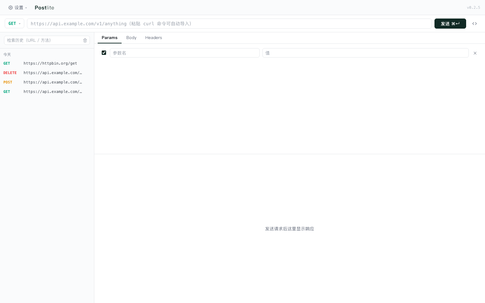
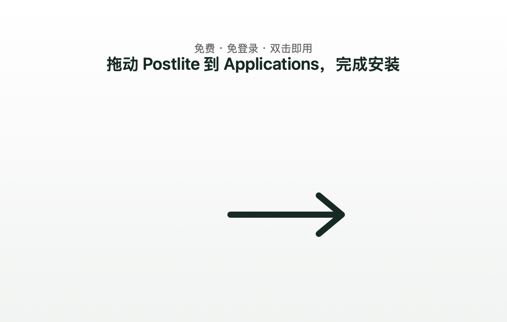

<div align="center">


# Postlite

**本机轻量 HTTP 调试工具** —— 粘贴 cURL 即发、表单化编辑、7 天历史。macOS 原生窗口，免登录。

*A tiny native macOS HTTP client — paste cURL, send, done.*

[](https://github.com/garrib/postlite/releases)
[](LICENSE)
[](https://github.com/garrib/postlite/releases)
[](https://go.dev)
[](go.mod)

</div>

---

## 为什么是 Postlite

调试一个接口，要的不是 Postman 的账号、云同步和工作区，而是一个能随手发请求的**原生小工具**：

- 浏览器里调接口被 CORS / 混合内容卡住？Postlite 由本地服务转发，**没有跨域限制**
- Postman 太重、Electron 占内存？Postlite 单二进制 ≈ 6MB，Swift 原生窗口
- 接口调完就忘？历史**自动保留 7 天**，过期的自己清理，不用管理集合和分组

## 特性

- 📋 **粘贴 cURL 即发** —— Chrome「Copy as cURL」直接粘进 URL 框自动导入，兼容 bash/zsh 续行、Windows cmd `^`、PowerShell 反引号；解析不了的旗标进提醒条，绝不整体失败
- 🧩 **表单化编辑** —— Query / Headers / Body（`json` · `x-www-form-urlencoded` · `form-data` · `raw` · `binary`），json 语法高亮、form-data 文件字段换/清随心
- ⚡ **本地代理转发** —— 上游 4xx/5xx 原样透传；跟随重定向、跳过证书校验、超时三个开关收在系统菜单栏「设置…⌘,」
- 🖼 **响应查看** —— JSON Pretty 高亮、图片内嵌预览、Headers / 复制 / 下载（走系统保存面板）、20MB 大响应自动截断保护
- 🕘 **Postman 风历史** —— 仅方法 + URL、按日分组、检索回填，保留 7 天自动清理，不做接口分组
- 📤 **cURL 导出** —— `</>` 按钮，把当前表单反向生成可粘贴回终端的 curl 命令
- 🔒 **免登录** —— 服务只绑 `127.0.0.1`，绝不上听局域网；这就是安全边界，无需账号

## 界面预览



## 安装

### 下载 Release（推荐）

从 [Releases](https://github.com/garrib/postlite/releases) 下载 `Postlite-<版本>-macos-universal.dmg`（Apple Silicon + Intel 双架构）：

1. 打开 DMG，把 **Postlite 拖入 Applications** 完成安装
2. 双击打开（ad-hoc 签名，若 Gatekeeper 拦截请右键 → 打开）
3. 窗口自动出现，开调

<div align="center"></div>

### 从源码构建

```bash
git clone https://github.com/garrib/postlite.git
cd postlite
make app          # 产出 bin/Postlite.app（当前架构）
make release      # 产出 universal 拖装 DMG dist/Postlite-<版本>-macos-universal.dmg
```

依赖：Go 1.25+、Xcode Command Line Tools（swiftc）、Node 20+（前端构建）。

## 使用

| 操作 | 方式 |
|---|---|
| 发送请求 | 填方法 / URL / 表单 → 点「发送」或 **⌘↵** |
| 导入 cURL | 把 curl 命令**直接粘进 URL 输入框**，自动识别 |
| 导出 cURL | URL 栏右侧 **`</>`** 按钮 |
| 回填历史 | 左侧历史面板点条目 |
| 清空历史 | 检索框内嵌 🗑 icon，或「设置…⌘,」→ 清空历史记录 |
| 发送选项 | 系统菜单栏 → **设置… ⌘,**（跟随重定向 / 跳过证书 / 超时） |
| 退出 | **⌘Q**（服务子进程随之退出） |

## 架构

```
Postlite.app（双击）
└── Postlite — Swift 壳：WKWebView 原生窗口、菜单栏、NSSavePanel 下载
      └── 拉起子进程 postlite-server（Go 标准库，零第三方依赖）
            ├── 仅监听 127.0.0.1:7300（端口被占自动 +1，最多 +50）
            ├── 代理转发 /api/proxy —— 上游状态原样透传，无 CORS 限制
            ├── 历史 /api/history —— 7 天保留，JSON 原子写，损坏自动归档
            └── go:embed 内嵌 Vue3 前端（gzip ≈ 40KB）
```

- **壳**：单文件 Swift（AppKit + WKWebView），`swiftc` 直编，不经 SPM；父进程被强杀时子进程 2 秒内自杀（防孤儿）
- **服务**：`internal/proxy`（信封构建与转发）、`internal/history`（存储与清理）、`internal/server`（路由 + 静态 + SPA 兜底）
- **前端**：Vue 3 + Vite + TypeScript，纯逻辑层（curl 解析 / 参数同步 / 高亮）全部单测覆盖

## 数据与安全

| 项 | 说明 |
|---|---|
| 数据文件 | `~/Library/Application Support/postlite/history.json`（权限 0600，temp+rename 原子写） |
| 保留策略 | 7 天（启动/写入时惰性清理），上限 10000 条 |
| 监听地址 | 仅 `127.0.0.1`，局域网不可达（已实测）——免登录的信任基础 |
| 捕获上限 | 响应 20MB 截断；请求体 2MB；单文件 14MB |
| 环境变量 | `POSTLITE_PORT`（起始端口）· `POSTLITE_NO_OPEN=1` · `POSTLITE_DATA_DIR` · `POSTLITE_WATCH_PARENT=1` |

## 开发

```bash
make test         # Go 三包 + 前端 vitest 全量测试
make run          # CLI 形态本地起服务（自动开浏览器）
cd frontend && npm run dev   # Vite 热更新（:5174，/api 代理到 7300）
```

设计文档（文档先行）：[docs/design.md](docs/design.md) · [docs/api.md](docs/api.md) · [docs/data.md](docs/data.md) · [docs/test-cases.md](docs/test-cases.md)

```
docs/             设计 / 接口 / 数据 / 测试用例 四份基线文档
ui/               Swift 原生壳（单文件）
scripts/          图标生成（CoreGraphics → iconset → icns）
frontend/         Vue 3 前端（src/lib 纯逻辑 + src/components）
internal/         Go：proxy / history / server / config
```

## 边界（刻意不做）

接口分组 / 集合 / 环境变量、账号与云同步、前置后置脚本、断言、Mock Server、WebSocket 专编。

有需求先改 [docs/design.md](docs/design.md)，再动代码。

## License

[MIT](LICENSE) © 2026 garrib
